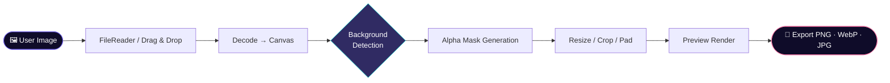
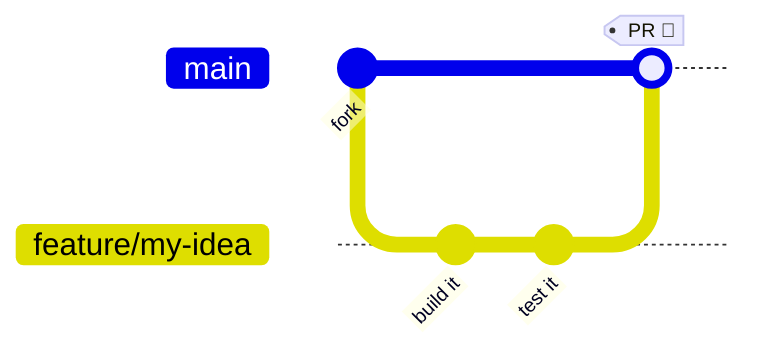

<div align="center">
<!-- ═══════════════════════════════════════════════════════════════════════════
     HEX — COSMIC BACKGROUND REMOVER & RESIZER
     README.md · maintained by @HexSleuth
     ═══════════════════════════════════════════════════════════════════════════ -->

<!-- ─────────────── ANIMATED WAVING HEADER ─────────────── -->
<a href="https://github.com/HexSleuth/HEX-Background-Remover-Resizer">
  
</a>

<!-- ─────────────── ANIMATED TYPING TAGLINE ─────────────── -->
<a href="https://github.com/HexSleuth/HEX-Background-Remover-Resizer">
  
</a>

<br/>

<!-- ─────────────── REALTIME REPO BADGES ─────────────── -->
<p>
  <a href="https://github.com/HexSleuth/HEX-Background-Remover-Resizer/stargazers">
    
  </a>
  <a href="https://github.com/HexSleuth/HEX-Background-Remover-Resizer/network/members">
    
  </a>
  <a href="https://github.com/HexSleuth/HEX-Background-Remover-Resizer/watchers">
    
  </a>
  <a href="https://github.com/HexSleuth/HEX-Background-Remover-Resizer/issues">
    
  </a>
  <a href="https://github.com/HexSleuth/HEX-Background-Remover-Resizer/pulls">
    
  </a>
</p>

<!-- ─────────────── REALTIME ACTIVITY BADGES ─────────────── -->
<p>
  <a href="https://github.com/HexSleuth/HEX-Background-Remover-Resizer/commits/main">
    
  </a>
  
  
  <a href="https://github.com/HexSleuth/HEX-Background-Remover-Resizer/security/policy">
    
  </a>
</p>

<!-- ─────────────── TECH + META BADGES ─────────────── -->
<p>
  
  
  
  
  
</p>

<!-- ─────────────── VISITOR COUNTERS ─────────────── -->
<p>
  
  
</p>

</div>

---

<div align="center">

### 🌌 *"Strip the noise. Keep the signal."*

**HEX** is a single-file, browser-native toolbox for **removing image backgrounds** and **resizing** them with pixel-perfect control — wrapped in a cosmic interface that makes image editing feel like stargazing.

[**🚀 Launch Live Demo**](https://hexsleuth.github.io/HEX-Background-Remover-Resizer/) · [**🐛 Report Bug**](https://github.com/HexSleuth/HEX-Background-Remover-Resizer/issues/new) · [**✨ Request Feature**](https://github.com/HexSleuth/HEX-Background-Remover-Resizer/issues/new) · [**🔐 Security**](https://github.com/HexSleuth/HEX-Background-Remover-Resizer/security/policy)

</div>

---

## 📖 Table of Contents

<details open>
<summary><b>Click to expand / collapse</b></summary>

- [✨ Features](#-features)
- [🎬 Live Demo](#-live-demo)
- [🛠️ Tech Stack](#️-tech-stack)
- [🏗️ Architecture](#️-architecture)
- [📂 Project Structure](#-project-structure)
- [🚀 Getting Started](#-getting-started)
- [🎨 Usage Guide](#-usage-guide)
- [🔐 Security Policy](#-security-policy)
- [🤝 Contributing](#-contributing)
- [🗺️ Roadmap](#️-roadmap)
- [📊 Activity & Stats](#-activity--stats)
- [❓ FAQ](#-faq)
- [📜 License](#-license)
- [💫 Acknowledgments](#-acknowledgments)

</details>

---

## ✨ Features

<div align="center">

| ⚡ Feature | 📝 Description |
| :--- | :--- |
| 🪄 **Background Removal** | Isolate subjects from their background with smart color/edge detection — no server round-trip, no uploads. |
| 📐 **Precision Resizer** | Scale, crop, and pad images with **aspect-ratio locking**, presets, and live dimension readouts. |
| 🖼️ **Multi-Format Export** | Export as **PNG** (with transparency), **WebP**, or **JPG** with a quality slider. |
| 🔒 **100% Client-Side** | Every pixel is processed locally in your browser via the Canvas API. **Your images never leave your device.** |
| 🎭 **Cosmic UI** | A dark, animated, nebula-themed interface with smooth transitions and zero layout shift. |
| 📦 **Single File** | The entire app lives in `index.html` — no build step, no `node_modules`, no framework. |
| 🖱️ **Drag & Drop** | Drop an image anywhere on the canvas to load it instantly. |
| ♿ **Accessible** | Keyboard navigable controls and high-contrast focus states. |
| 🌐 **Offline-Ready** | Once loaded, the app works without a network connection. |

</div>

---

## 🎬 Live Demo

<div align="center">

<a href="https://hexsleuth.github.io/HEX-Background-Remover-Resizer/">
  
</a>

</div>

> **No install. No sign-up. No tracking.** Just open the page and drop an image.

**Run it locally in 3 seconds:**

```bash
git clone https://github.com/HexSleuth/HEX-Background-Remover-Resizer.git
cd HEX-Background-Remover-Resizer
# then simply open index.html in your browser
```

---

🛠️ Tech Stack

<div align="center">

Layer Technology
Markup HTML5 (semantic, single-page)
Styling Modern CSS3 — custom properties, grid, flexbox, keyframe animations
Logic Vanilla JavaScript (ES6+)
Imaging HTML5 Canvas API · ImageData · FileReader · Blob
CI/CD GitHub Actions (.github/workflows)
Hosting GitHub Pages / any static host

</div>

<p align="center">
  
</p>

---

🏗️ Architecture



Flow at a glance:

1. Ingest — image is read locally via FileReader or the drag-and-drop API.
2. Decode — drawn onto an offscreen <canvas> for pixel-level access.
3. Detect — background pixels are identified and converted to transparency.
4. Transform — the cutout is resized/cropped/padded to the target dimensions.
5. Export — the result is encoded to a Blob and offered as a download.

---

📂 Project Structure

```text
HEX-Background-Remover-Resizer/
│
├── .github/
│   └── workflows/              # CI/CD automation
│
├── SECURITY.md                 # Security policy & vulnerability reporting
├── index.html                  # 🎯 The entire application
└── README.md                   # You are here
```

---

🚀 Getting Started

Prerequisites

· Any modern browser (Chrome, Firefox, Safari, Edge — last 2 versions)
· Nothing else. No Node, no npm, no Python.

Option 1 — Clone & Open

```bash
git clone https://github.com/HexSleuth/HEX-Background-Remover-Resizer.git
cd HEX-Background-Remover-Resizer
```

Then open index.html:

```bash
# macOS
open index.html

# Linux
xdg-open index.html

# Windows
start index.html
```

Option 2 — Serve Locally (recommended for development)

```bash
# Python 3
python -m http.server 8000

# or Node
npx serve .
```

Visit http://localhost:8000.

Option 3 — Fork & Enable GitHub Pages

1. Fork this repository.
2. Go to Settings → Pages.
3. Set Source to Deploy from a branch → Branch: main → Folder: / (root).
4. Save — your copy goes live at https://<your-username>.github.io/HEX-Background-Remover-Resizer/.

---

🎨 Usage Guide

<table>
<tr>
<td width="50%" valign="top">

🪄 Removing a Background

1. Drop an image onto the canvas — or click to browse.
2. Adjust the tolerance / threshold slider until the subject is cleanly isolated.
3. Use the eraser / restore brush to refine edges.
4. Hit Export and choose PNG to preserve transparency.

</td>
<td width="50%" valign="top">

📐 Resizing an Image

1. Load your (cutout) image.
2. Enter a width or height — the other follows when 🔒 lock ratio is on.
3. Pick a preset (1:1, 4:5, 16:9, 9:16, 3:2) or define a custom box.
4. Choose fit (contain), fill (cover), or stretch.
5. Export at full quality.

</td>
</tr>
</table>

💡 Pro tip: Work at the highest resolution you have, then downscale on export — you'll get crisper alpha edges than upscaling a small cutout.

---

🔐 Security Policy

This project takes security seriously. Please read SECURITY.md before reporting an issue.

Supported Versions

Version Supported
5.1.x ✅
5.0.x ❌
4.0.x ✅
< 4.0 ❌

Reporting a Vulnerability

⚠️ Please do not open a public issue for security vulnerabilities.

· 📧 Report privately via GitHub Security Advisories or by contacting @HexSleuth directly.
· ⏱️ Expected response: acknowledgment within 48–72 hours.
· 🔄 Status updates: provided at least every 7 days until resolution.
· ✅ If accepted: a patch is prepared, a CVE is requested where applicable, and you're credited in the release notes (unless you prefer to stay anonymous).
· ❌ If declined: you'll receive a written explanation of the reasoning.

<div align="center">

https://img.shields.io/badge/🔒_Privacy-Images_Never_Leave_Your_Device-00B894?style=for-the-badge&labelColor=0F0C29

</div>

---

🤝 Contributing

Contributions of every size are welcome — from typo fixes to entire features.



Quick Contribution Flow

1. 🍴 Fork the repo
2. 🌿 Branch: git checkout -b feature/amazing-idea
3. 💾 Commit: git commit -m "feat: add amazing idea"
4. 📤 Push: git push origin feature/amazing-idea
5. 🎉 Open a Pull Request

Commit Convention

Prefix Meaning
feat: New feature
fix: Bug fix
docs: Documentation only
style: Formatting, no logic change
refactor: Code restructure
perf: Performance improvement
chore: Tooling / maintenance

Guidelines

· Keep index.html dependency-free unless there's a strong, discussed reason.
· Test in Chrome, Firefox, and Safari before submitting.
· Match the existing cosmic design language.
· One feature/fix per pull request.

---

🗺️ Roadmap

☑ Core background removal engine
☑ Precision resizer with aspect-ratio lock
☑ Multi-format export (PNG / WebP / JPG)
☑ Cosmic dark UI with animations
☑ Security policy established
☐ 🚧 Batch processing (multiple images at once)
☐ 🚧 AI-assisted subject segmentation
☐ 🚧 Custom background replacement (color / gradient / image)
☐ 🚧 PWA support + offline install
☐ ⬜ Undo / redo history stack
☐ ⬜ Keyboard shortcut palette

Have an idea? Open a feature request →

---

📊 Activity & Stats

<div align="center">

<!-- ─── REALTIME REPO STAT CARDS ─── -->

<a href="https://github.com/HexSleuth/HEX-Background-Remover-Resizer">
  
</a>

<!-- ─── TOP LANGUAGES ─── -->


<!-- ─── ANIMATED CONTRIBUTION ACTIVITY GRAPH ─── -->

<a href="https://github.com/HexSleuth">
  
</a>


<!-- ─── STAR HISTORY ─── -->

<a href="https://star-history.com/#HexSleuth/HEX-Background-Remover-Resizer&Date">
  
</a>

</div>

---

❓ FAQ

<details>
<summary><b>🔒 Do my images get uploaded to a server?</b></summary>
<br/>
<b>No.</b> Every operation runs in your browser using the Canvas API. There is no backend, no analytics on image data, and no network request carrying your file. You can verify this by opening DevTools → Network tab while using the app.
</details>

<details>
<summary><b>📦 Why a single <code>index.html</code>?</b></summary>
<br/>
Simplicity and portability. A single file can be dropped on any static host, opened directly from disk, audited in one sitting, and forked without a build toolchain. It also guarantees the app keeps working decades from now.
</details>

<details>
<summary><b>🌐 Does it work offline?</b></summary>
<br/>
Yes. Once the page and its assets are cached, the entire tool functions without a network connection.
</details>

<details>
<summary><b>🖼️ Which formats are supported?</b></summary>
<br/>
<b>Input:</b> PNG, JPG/JPEG, WebP, GIF (first frame), and BMP — anything your browser can decode.<br/>
<b>Output:</b> PNG (transparency preserved), WebP (best size/quality ratio), JPG (no transparency).
</details>

<details>
<summary><b>📱 Is there a mobile version?</b></summary>
<br/>
The interface is fully responsive and works on modern mobile browsers, though precision brushing is naturally easier with a mouse or stylus.
</details>

<details>
<summary><b>🐛 I found a security issue. What do I do?</b></summary>
<br/>
Please <b>do not</b> open a public issue. Follow the <a href="#-security-policy">Security Policy</a> above and report it privately.
</details>

---

📜 License

This project is distributed under the MIT License — free to use, modify, and share.

```text
MIT License · Copyright (c) 2026 HexSleuth

Permission is hereby granted, free of charge, to any person obtaining a copy
of this software and associated documentation files (the "Software"), to deal
in the Software without restriction, including without limitation the rights
to use, copy, modify, merge, publish, distribute, sublicense, and/or sell
copies of the Software, subject to the following conditions:

The above copyright notice and this permission notice shall be included in
all copies or substantial portions of the Software.

THE SOFTWARE IS PROVIDED "AS IS", WITHOUT WARRANTY OF ANY KIND.
```

ℹ️ No LICENSE file is currently present in the repository — add one to make this official.

---

💫 Acknowledgments

<div align="center">

💜 Thanks to
🎨 The open-source design community for the cosmic UI inspiration
🛡️ Everyone who reports vulnerabilities responsibly
⭐ Every stargazer, forker, and contributor — you keep this project orbiting
🌍 The Canvas API — quietly doing all the heavy lifting since 2004

</div>

---

<div align="center">

🌠 Star this repo if HEX saved you a trip to Photoshop

<a href="https://github.com/HexSleuth/HEX-Background-Remover-Resizer/stargazers">
  
</a>
<a href="https://github.com/HexSleuth/HEX-Background-Remover-Resizer/fork">
  
</a>
<a href="https://github.com/HexSleuth/HEX-Background-Remover-Resizer/issues">
  
</a>


<!-- ─────────────── ANIMATED FOOTER WAVE ─────────────── -->


<sub>
  <b>HEX</b> — Cosmic Background Remover & Resizer · v5.1.x<br/>
  Made with 🌌 and vanilla JavaScript · © 2026 <a href="https://github.com/HexSleuth">HexSleuth</a>
</sub>

</div>


### Cosmic README & Live Stats

This README feels like a mini product page: a glowing header, a typing SVG, and lots of realtime badges that update on their own.

- **Animated hero area** — The waving header and typing tagline set the cosmic tone right away.
- **Realtime repo badges** — Stars, forks, watchers, issues, PRs, last commit, and CI status all pull live data from shields.io.
- **Badge categories** — Tech stack badges (HTML5, CSS3, JavaScript, Canvas API, zero dependencies) and visitor counters keep the metadata fresh.
- **Animated stats section** — GitHub stats cards, a contribution activity graph, and a star-history chart add moving visuals.
- **Security spotlight** — The supported-version table and vulnerability reporting steps are pulled directly from the repo’s SECURITY.md.
---

**Optimization Tip:** You can swap the `?style=for-the-badge` parameter on any shields.io badge to `flat` or `plastic` for a different look. To make the CI badge work, update the `check-runs` endpoint to your actual workflow file name.
